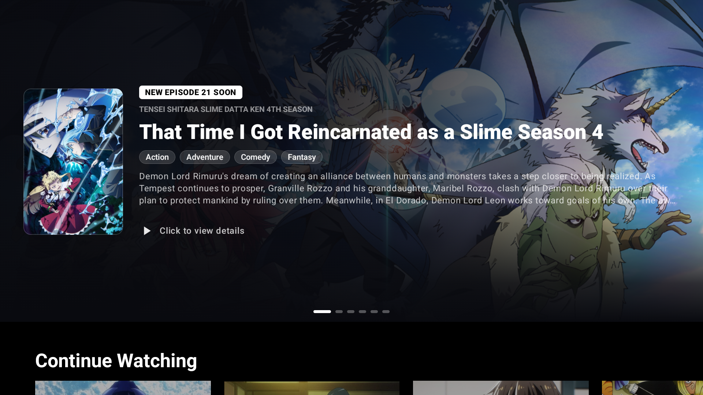
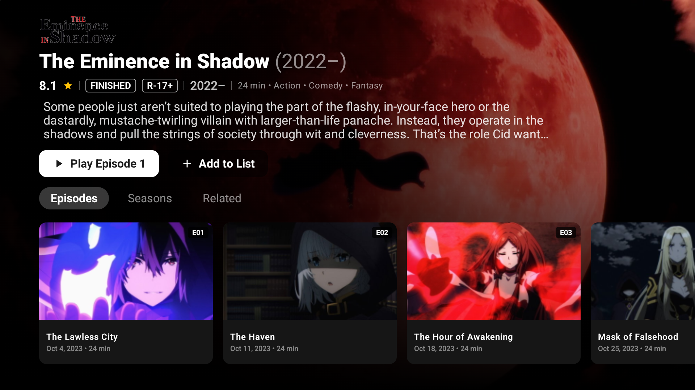
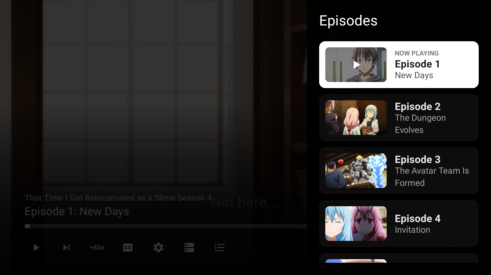
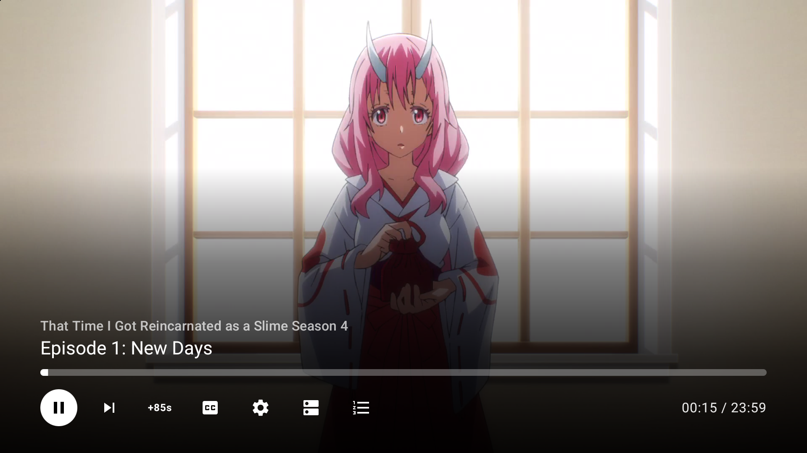
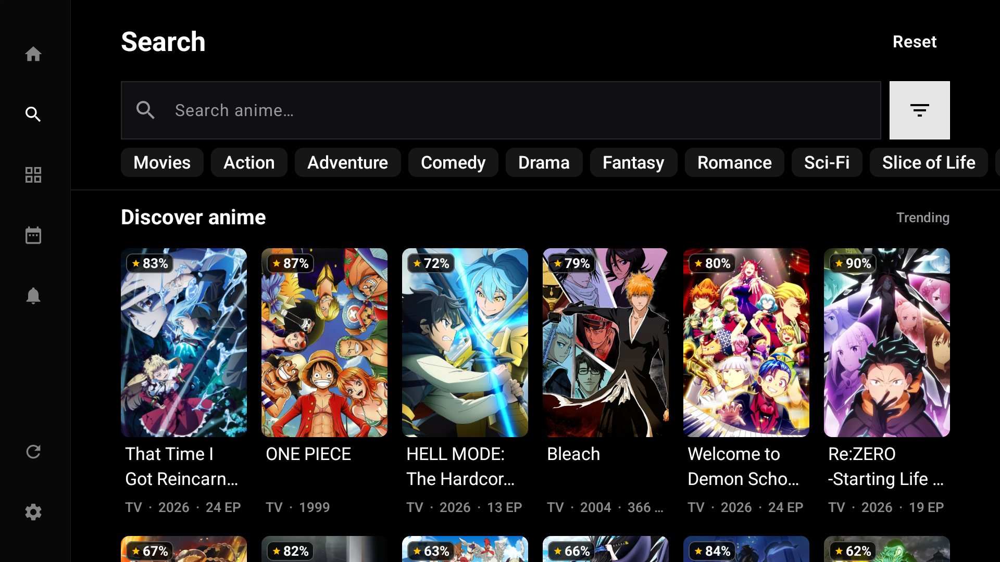
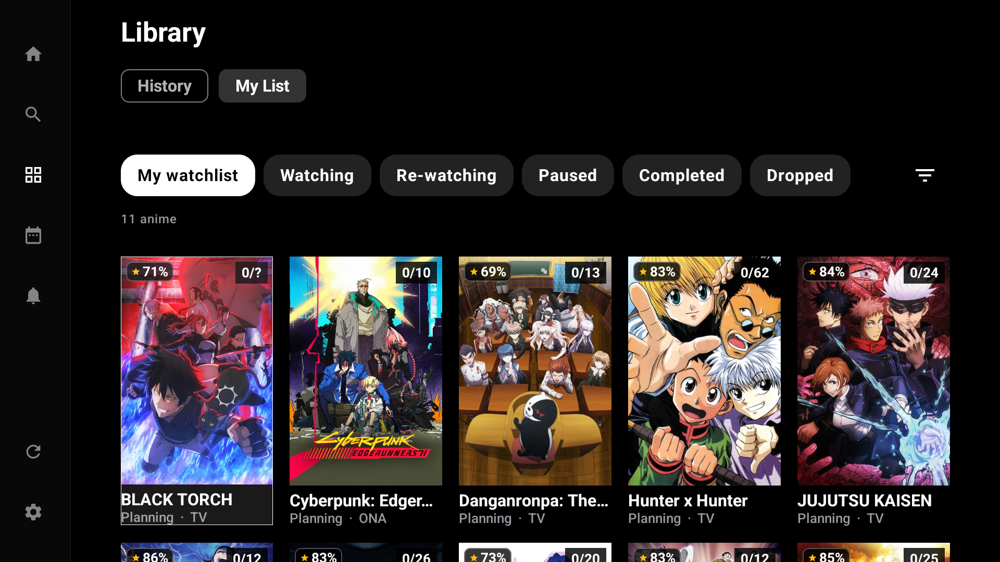

  <h1>AnikenTV</h1>
  
A native, fast, and feature-rich anime streaming client tailored for the big screen.

  

    <!-- Top row -->
    
      
    <!-- Bottom row -->
    
    
  

---

## 📺 About

**AnikenTV** is a native anime streaming application built specifically for Android TV and Google TV devices. It is a fork of Anilili app, bringing a refreshed modern interface, reliable D-pad navigation, robust playback performance, and expanded streaming sources directly to your television.

---

## ✨ Features & Highlights

- **TV-Optimized Modern UI:** Designed specifically for leanback navigation with native focus states, smooth transitions, and high-contrast D-pad remote support.
- **Powerful Video Player:** Robust media engine supporting fast HLS/DASH streaming, dynamic quality switching, episode auto-play, intro/outro skipping, and custom aspect-ratio scaling.
- **Multi-Source Scraping:** Aggregates streams across a wide range of fast providers, including Miruro, AniKoto, ReAnime, AniZone, AniNeko, AniBD, 2DHive, and more.
- **Seamless Account Sync:** Direct two-way tracking with AniList** and MyAnimeList to sync watch history, episode progress, ratings, and custom watchlists automatically.
- **Hardware-Accelerated Decoding:** Direct on-device stream decoding via Miruro pipe endpoints alongside fallback WebView/embed client resolution.
- **Episode & Server Management:** Quick server fallback switching, sub/dub toggling, and multi-audio stream selection on the fly.

---

## 🖼️ Showcase

  
  
  
  
  
  
  
  

---

## 📥 Installation

1. Download the latest release APK from the [Releases page](https://github.com/gg-shub/anilili-tv/releases).
2. Sideload the APK onto your Android TV / Google TV box using **ADB**, a flash drive, or a local file transfer app (such as *Send Files to TV*).
3. Open **AnikenTV** and start watching.

---

## 💬 Community & Support

Have a question, feature request, or need to report a broken provider? Join the community server:

  

---

## ⚠️ Disclaimer

> **Note:** AnikenTV is a non-commercial, personal, and educational project. It does not host any media files or content on its own servers. All media is resolved through third-party indexers and public APIs (AniList, MyAnimeList, Miruro, AniKoto, ReAnime, AniZone, AnimeGG, AniNeko, AniBD, 2DHive). This project is not officially affiliated with or endorsed by any of the listed third parties.

